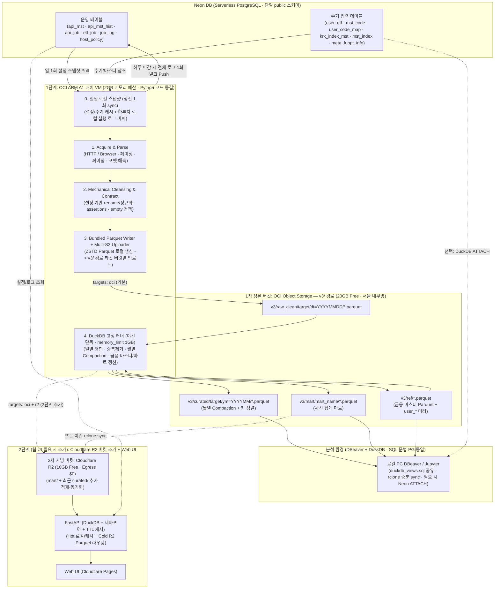

# 데이터 설정 기반 스크래핑 앱 재설계 아키텍처 (Neon DB + Parquet + DuckDB)

본 문서는 `pyscrap` v1→v2 운영 경험과 아키텍처 리뷰를 바탕으로 확정한 차세대 설계안입니다.
**컨트롤 DB는 Neon DB(Serverless PostgreSQL)**로, **대용량 수집·가공·분석은 OCI Bucket Parquet + DuckDB**로 확정하고, 향후 웹 UI 확장 시 **Cloudflare R2 버킷을 추가**하는 구조로 설계합니다.

---

## 0. 핵심 설계 원칙

1. **Neon DB(최소 운영·수기 DB) + Parquet/DuckDB(데이터·분석) 이원화**: Oracle · `XT_*` · `DBMS_CLOUD` 아카이브를 완전히 폐기하고, Neon에는 **신규 운영 테이블과 최소 `ref`/수기 테이블만** 유지한다.
2. **하루치 전체 배치의 로컬 실행 + 일괄 동기화**: 3분 작업뿐 아니라 **하루치 전체 배치(`3m`·`5m`·`1h`·`daily_*`)**가 로컬 스냅샷 캐시로 동작하고 마감 시 Neon에 1회 벌크 반영하여, Neon Scale-to-Zero(무료 CU-hours)와 장애 격리를 극대화한다.
3. **DB-First 설정 & DDL 변경 0 + Python 엔진 동결**: 설정은 Neon `api_mst`의 단일 `spec_json (JSONB)`(`engine` + `ext`)으로 관리하고, Python은 수집·포맷 해독·기계적 정제·Parquet 적재·고정 DuckDB 러너 역할만 맡고 동결한다.
4. **멀티 버킷 추가 확장(전환 아님)**: 1단계는 **OCI Object Storage(20GB, 1차 정본)**로 운영하고, 2단계 웹 UI 필요 시 OCI를 교체하지 않고 **Cloudflare R2(10GB, 조회·서빙용) 버킷을 추가**하는 멀티 타깃 구조로 구성한다.

---

## 1. 전체 아키텍처 개요



---

## 2. Neon DB 최소 구성 및 금융 마스터 저장 위치 비교

### 2-1. Neon DB 테이블 최소화 (단일 `public` 스키마 · 운영 + `user_*` 수기 테이블만 유지)
결과 테이블 43개와 금융 마스터까지 모두 버킷 Parquet(`v3/`)으로 이동하므로, Neon DB에는 **소형 운영·수기 테이블만** 남습니다. 스키마를 나눌 필요 없이 기본 **`public` 단일 스키마**로 통합해 `search_path` 설정이나 스키마 접두사 없이 바로 조회·편집합니다.
* **운영 테이블**: `api_mst`, `api_mst_hist`, `api_job` (API 수집 잡), `etl_job` (DuckDB 가공·컴팩션·마스터 갱신 SQL 잡), `v_schedule_job` (통합 스케줄 순서 뷰), `job_log` (통합 실행 이력 + 멱등성 원장), `host_policy`
* **수기 입력 테이블**: `user_etf`, `mst_code`, `user_code_map`, `krx_index_mst`, `mst_index`, `meta_fuopt_info` 등 **재수집 불가능한 수기 데이터** — 향후 수기 보정·오버라이드가 필요할 때만 `user_xxx` 테이블을 추가
* 향후 배치 전용 Role 권한 분리가 필요해지면 테이블 단위 `GRANT`(`user_*`는 `SELECT`만 허용)로 제어합니다.

### 2-2. 확정 결정: 방식 B — 금융시장 데이터 전체를 버킷 Parquet으로 일원화
운영 테이블(`api_mst`, `api_job`, `etl_job`, `job_log`)과 수기 테이블(`user_*`)은 Neon DB에 두고, 수집물에서 자동 파생되는 **모든 금융시장 데이터(금융 마스터 `mst_etf`·`mst_fuopt`·`mst_bond`·`mst_stock`·`mst_index`·`meta_maturity`·`stock_index_his` 포함)**는 **버킷 Parquet(`v3/ref/*.parquet`)으로 일원화**합니다.

| 비교 축 | 방식 A (금융 마스터도 Neon 저장) | **방식 B (확정) — 금융 데이터 전체 버킷 Parquet** |
|---|---|---|
| **Neon DB 구성** | 운영 + 수기 + 금융 마스터 (~17개 표, ~80MB) | **운영(~6개) + 수기 `user_*`만 (~10개 표, ~10MB 미만)** |
| **마스터 동기화** | 원천 → Neon `MERGE` → 버킷 미러링 (이중 저장) | **DuckDB가 수집 Parquet + 기존 `v3/ref/*.parquet`을 합쳐 갱신 (단일 정본)** |
| **수집 대상 조회** | 배치 시작 시 Neon에서 대량 `SELECT` | **VM의 DuckDB가 로컬/버킷 `v3/ref/*.parquet`에서 즉시 조회 (Neon 접속 0)** |
| **수동 보정** | 마스터 행 직접 `UPDATE` (동기화 덮어쓰기 위험) | **필요 시 Neon에 `user_xxx` 수기 테이블 생성 → DuckDB 병합 시 `COALESCE(user_val, auto_val)`로 덮어쓰기** |
| **무결성 · 백업** | PG PK/UNIQUE | DuckDB 갱신 SQL에 `QUALIFY ROW_NUMBER() = 1` + `min_rows` 계약 검사 + 버킷 오브젝트 버저닝 |
| **복구 단위** | 재수집 가능/불가 데이터 혼재 | **Neon = 재수집 불가(운영·수기) / 버킷 = 재수집 가능(모든 금융 데이터)** |

> [!IMPORTANT]
> **수기 보정 원칙 (`user_xxx`)**: `v3/ref/mst_*.parquet`은 100% 자동 파생물로 유지하고 직접 수정하지 않습니다. 특정 종목·만기·ETF에 사람의 수동 보정이 필요하면 Neon(`public`)에 `user_xxx` 테이블을 만들어 관리하고, DuckDB 마스터 생성 SQL에서 `COALESCE(user_xxx.col, auto.col)`로 합칩니다.

### 2-3. 하루치 전체 배치의 Neon Scale-to-Zero & 벌크 동기화 규칙
3분 작업(`3m_call`, `3m_put`)만 예외로 두지 않고, **일별 배치(`daily_*`)와 장중 배치(`3m`·`5m`·`1h`)를 포함한 하루치 전체**에 동일한 일괄 처리 패턴을 적용합니다.

```text
[06:30 장전 — Neon 1회 접속 (~10초)]
  Neon 설정/수기  ──(1회 벌크 Pull)──▶  OCI A1 VM 로컬 스냅샷 (data/cache/config_snapshot.json)

[06:30 ~ 23:30 하루 전체 배치 — Neon 접속 0회!]
  daily_start · daily_early · 3m · 5m · 1h · daily_batch1 · daily_batch2 · daily_close
  → 로컬 스냅샷을 읽고 수집·정제·버킷 Parquet 업로드
  → 모든 잡의 실행 로그는 VM 로컬 NDJSON (data/logs/ledger/job_log_YYYYMMDD.ndjson)에 누적

[야간 마감 — Neon 1회 접속 (~20초)]
  로컬 누적 로그(하루치 전체)  ──(1회 벌크 COPY/INSERT)──▶  Neon job_log
  (긴급 설정 변경 시에만 수동 명령 `pyscrap sync-config`로 즉시 재동기화)
```

* **효과 1 (무료 CU-hours 극대화)**: Neon은 하루에 딱 **2번(총 1~2분)**만 깨어나고 23시간 58분은 Scale-to-Zero로 잠듦 → 월 Compute 사용량 1~2 CU-hours 수준.
* **효과 2 (레이턴시 & 장애 격리)**: OCI 서울 VM ↔ Neon 리전 간 왕복 지연(~60~80ms)이 수집 속도에 전혀 영향을 주지 않으며, Neon 일시 점검 중에도 당일 배치는 중단 없이 완주.
* **접속 설정**: Neon **Pooled Connection String (`-pooler`)** + `pool_pre_ping=True` + `connect_timeout=10`.

---

## 3. 파이프라인 상세: Python 정제 → 멀티 버킷 Parquet → DuckDB 추가 처리

### Stage 1. Acquire & Parse (Python 고정 엔진)
* **전송·복원력**: HTTP(`httpx`) / Browser(`Playwright`), `host_policy` 기반 페이싱, 차단 쿨다운, 세션 만료 자동 재로그인, `page`/`cursor`/`token` 페이징 및 경계 중복 병합(`merge_records`).
* **포맷 해독**: JSON, XML, CSV/Delimited, ZIP 내 Delimited, HTML Table, HTML Block, XLSX/XLS, Binary → 균일한 Flat `dict` 스트림으로 변환.
* **보안 격리**: `${VAR}` 시크릿 치환은 `SCRAP_*` 네임스페이스만 허용(`DATABASE_URL`, `S3_*` 유출 차단). 동적 토큰/쿠키는 `.env` 덮어쓰기 대신 로컬 `session_store`로 분리.

### Stage 2. Mechanical Cleansing, Contract & Multi-Bucket S3 Upload (Python 고정 엔진)
* **설정 기반 기계적 정제 (`spec_json.engine.cleanse`)**:
  * 기존 `VendorRecordBase` · `MdcRecordBase` · `EtfPdfDateMixin` 로직을 내장 필터(`rename`, `strip`, `blank_to_null`, `dash_to_null`, `strip_comma`, `digits_only`, 타입 캐스팅)로 일반화 → 사이트 포맷 변경 시 **Python 수정 0**.
* **적재 전 데이터 계약 검사 (`spec_json.engine.contract`)**:
  * `empty_policy` (`succeed` | `pending` | `keep_previous` | `fail`), `min_rows`, 필수 컬럼 `not_null`, 금지 문자열(`"데이터가 없습니다."`) 검사.
* **멀티 버킷 추가 구성 (`oci` 기본 + `r2` 추가 — 전환이 아닌 병행)**:
  * `app/object_storage.py`를 단일 클라이언트가 아닌 **이름 기반 멀티 S3 타깃 레지스트리(`get_storage(name)`)**로 구성합니다.
    ```env
    # 1단계 (기본 정본 버킷 — 항상 활성)
    S3_OCI_ENDPOINT_URL=https://<ns>.compat.objectstorage.<region>.oraclecloud.com
    S3_OCI_BUCKET=<oci-bucket>
    S3_OCI_ACCESS_KEY=...
    S3_OCI_SECRET_KEY=...

    # 2단계 (웹 UI 필요 시 추가 — 비어 있으면 비활성)
    S3_R2_ENDPOINT_URL=https://<account_id>.r2.cloudflarestorage.com
    S3_R2_BUCKET=<r2-bucket>
    S3_R2_ACCESS_KEY=...
    S3_R2_SECRET_KEY=...
    ```
  * 각 소스(`api_mst`) 또는 `etl_job` 설정에서 `targets: ["oci"]` (기본) 또는 `targets: ["oci", "r2"]` (웹 UI 서빙 대상)를 선언하면, 로컬에서 생성한 **동일한 ZSTD Parquet 파일 1개를 지정된 버킷들에 순차 업로드**합니다.
  * **업로드 전략**: 잡 1건마다 개별 PUT하지 않고 **사이클/일 단위로 묶어 업로드**해 OCI 월 50,000 API 요청 한도를 여유 있게 유지.
  * **총 30GB 무료 동시 활용**: OCI(20GB, 전체 원천·장기 아카이브 정본) + Cloudflare R2(10GB, 웹 UI용 `mart/`·최근 `curated/` 고속 서빙)를 함께 운용.
* **버킷 경로 규약 (`v3/` 접두사 + DuckDB Hive 파티셔닝 최적화)**:
  기존 v2 버킷 데이터와 100% 격리하기 위해 모든 v3 객체는 `v3/` 아래에 적재합니다.
  ```text
  s3://<bucket>/v3/ref/<table_name>.parquet                                # 금융 마스터 & 수기 미러 Parquet
  s3://<bucket>/v3/raw_clean/<target>/dt=YYYYMMDD/<batch_or_ts>.parquet    # 일별/스냅샷 정제본
  s3://<bucket>/v3/curated/<target>/ym=YYYYMM/dt=YYYYMMDD/data.parquet     # DuckDB 일별 병합·중복제거본
  s3://<bucket>/v3/curated/<target>/ym=YYYYMM/monthly.parquet              # DuckDB 월별 Compaction본 (키 정렬)
  s3://<bucket>/v3/mart/<mart_name>/data.parquet                           # DuckDB 사전 집계 마트 (웹 UI/리포트용)
  s3://<bucket>/v3/binary/<group>/<file_name>                              # 다운로드 문서(PDF/ZIP 등)
  ```

### Stage 3. DuckDB 추가 처리 (SQL은 Neon DB 데이터로 분리, Python 수정 0)
* **고정 DuckDB 러너**: Python에는 `etl_job` 설정(로컬 스냅샷에 포함)의 `sql_text`를 실행하고 결과를 로컬 Parquet 생성 → 지정된 `targets` 버킷(`["oci"]` 또는 `["oci", "r2"]`)에 업로드하는 고정 러너만 유지.
* **일별/월별 처리 흐름**:
  1. 장중 스냅샷(3분/5분): 사이클 단위 소형 Parquet을 OCI `v3/raw_clean/.../dt=YYYYMMDD/`에 누적.
  2. 장 마감 후(야간 단독): DuckDB가 당일 `v3/raw_clean`을 읽어 중복 제거·정렬 후 `v3/curated/<target>/ym=YYYYMM/dt=YYYYMMDD/data.parquet` 1개 파일로 병합 + 금융 마스터(`v3/ref/*.parquet`) 갱신 + `v3/mart/` 생성(2단계 시 `v3/mart/`·최근 `v3/curated/`는 R2에도 추가 업로드).
  3. 월말/월초(야간 단독): 해당 월의 일별 파일을 **`ORDER BY short_code, trade_date` 등 주 조회키로 정렬**해 `v3/curated/<target>/ym=YYYYMM/monthly.parquet` 1개 파일(50~200MB)로 통합하고 옛 일별 파일 정리.

---

## 4. DB-First 설정 아키텍처 (Neon PostgreSQL · DDL 변경 0)

```sql
CREATE TABLE api_mst (
    api_id          VARCHAR(150) PRIMARY KEY,
    api_name        VARCHAR(100) NOT NULL,
    source_name     VARCHAR(20)  NOT NULL,   -- 인덱스/조회용
    domain          VARCHAR(20),             -- 인덱스/조회용
    protocol        VARCHAR(10)  NOT NULL CHECK (protocol IN ('HTTP', 'BROWSER')),
    sink_type       VARCHAR(15)  NOT NULL CHECK (sink_type IN ('PARQUET', 'BINARY', 'SESSION')),
    status          VARCHAR(10)  NOT NULL CHECK (status IN ('DRAFT', 'ACTIVE', 'PAUSED')),
    schema_version  SMALLINT     NOT NULL DEFAULT 1,
    spec_json       JSONB        NOT NULL,   -- engine(엄격) + ext(자유 확장)
    note            VARCHAR(400),
    updated_at      TIMESTAMPTZ  NOT NULL DEFAULT now()
);
```

* **네임스페이스 분리**:
  * `spec_json->'engine'`: Python이 해석하는 안정화된 Primitive만 포함(`request`, `pagination`, `extract`, `cleanse`, `contract`, `session`, `pacing`, `sink`[`targets` 포함]).
  * `spec_json->'ext'`: Python은 통과만 시키는 자유 영역(`additionalProperties: true`). 운영 인력이 커스텀 메타를 **Python 수정·DDL 변경 없이 자유롭게 추가**.
* **오타 방지 3중 방어**: Pydantic v2 모델 → `model_json_schema()` 자동 파생으로 **① API `POST/PATCH` 및 배치 `check-config` 사전 검증**, **② JSON Schema 기반 어드민 자동 폼**, **③ PostgreSQL 기본 구조 `CHECK` 제약** 적용.
* **운영 안전장치**: PostgreSQL `BEFORE UPDATE OR DELETE` 트리거로 `api_mst_hist`에 직전 스냅샷 자동 백업 + `DRAFT → pyscrap dry-run → ACTIVE` 워크플로.
* **작업 모델 (`Partition × Run Ledger`)**: 날짜별 `api_job` 행 누적 폐기 → 실행 시점에 `(대상 파티션) - (로컬/원장 SUCCEEDED)` 차집합만 실행하고 하루 마감 시 `job_log`에 일괄 적재.

---

## 5. OCI ARM A1 인스턴스 메모리 관리 (전체 2GB 예산)

### 5-1. 2GB 메모리 배분표

| 구성 요소 | 예상 점유 | 가드 / 제어 |
|---|---|---|
| OS / `systemd` / `journald` | ~300 MB | 기본 상주 (Neon은 외부 서버리스라 **VM RAM 0 MB**) |
| Python HTTP 배치 프로세스 | ~100 MB / 개 | 3분 샤드 2개 동시 실행 시 ~220 MB |
| Playwright Chromium (브라우저 잡) | ~350–500 MB | `flock`으로 무거운 DuckDB 작업과 배타적 실행 |
| DuckDB 경량 정제 (배치 중) | **상한 512 MB** | `threads=2`, 블록 디스크 스필 |
| DuckDB 일별 병합 / 월별 Compaction | **상한 1,024 MB** | 야간 단독 실행 (`flock /var/lock/pyscrap-heavy.lock`) |

* **최악 피크**: 평시 ~1.03 GB · 브라우저 실행 시 ~0.95 GB · 야간 단독 Compaction ~1.42 GB (< 2 GB 안전권).

### 5-2. DuckDB 필수 안전 설정
```python
con = duckdb.connect(":memory:", config={
    "memory_limit": "512MB",               # 일반 배치 512MB / 야간 단독 Compaction 1GB
    "threads": 2,                          # 코어 수만큼 버퍼 배증 방지
    "temp_directory": "data/tmp/duckdb",   # 반드시 tmpfs(/tmp)가 아닌 실제 블록 디스크 경로
    "preserve_insertion_order": False,     # 대용량 정렬/병합 시 메모리 피크 절감
})
```
* **주의 (`tmpfs` 회피)**: `/tmp`가 RAM 디스크(`tmpfs`)이면 스필이 RAM을 먹어 OOM이 나므로 반드시 블록 디스크 경로 사용.
* **스트리밍 & 해제**: 수만 행 이상 대형 잡은 `from_pylist()` 대신 임시 NDJSON 스트리밍 입력 → 작업 종료 즉시 `con.close()` + 임시 파일 삭제.
* **`systemd` 가드**: 무거운 배치 유닛에 `MemoryHigh=1500M` · `MemoryMax=1800M` 설정.

---

## 6. 분석 및 팀 공유 전략 (DBeaver + DuckDB)

* **로컬 DBeaver 연결**: DuckDB JDBC 드라이버(1.1+)로 로컬 메타 파일(`pyscrap_analytics.duckdb`)에 연결 → 최초 1회 `CREATE PERSISTENT SECRET`으로 OCI(또는 R2) 버킷 키 등록.
  * `PERSISTENT SECRET`은 `.duckdb` 파일이 아니라 사용자 홈 디렉터리(`~/.duckdb/stored_secrets/`)에 저장되므로 `.duckdb` 파일에 키가 남지 않음.
* **팀 공유 표준**: `.duckdb` 바이너리 파일 대신 **`scripts/sql/duckdb_views.sql` 텍스트 파일 1개를 Git으로 공유**. 팀원은 각자 PC에서 시크릿 1회 등록 후 `duckdb_views.sql`만 실행(`CREATE OR REPLACE VIEW`)하면 즉시 동일한 분석 환경 완성.
* **초고속 반복 분석/백테스트**: 전체 테이블을 매번 재구축할 필요 없이 **`rclone sync`로 로컬 폴더에 증분 동기화**(신규·변경 파일만 1~2초 다운로드) + 로컬 폴더 `VIEW` 사용 → 1천만 행 집계도 0.1~0.5초 내 완료.
* **마스터·수기 데이터 조인**: 금융 마스터는 버킷의 `v3/ref/*.parquet`으로 Neon 깨움 없이 조인하고, 수기 테이블(`user_etf`, `user_code_map`, `user_xxx`)이 필요할 때만 `ATTACH 'postgresql://...' AS neon (TYPE POSTGRES, READ_ONLY)` 또는 일일 미러(`v3/ref/user_*.parquet`)로 조인.

---

## 7. 스토리지 무료 티어 비교 및 2단계 웹 UI 확장 (Cloudflare R2 추가)

### 7-1. S3 호환 버킷 무료 티어 비교

| 서비스 | 영구 무료 | 무료 저장 | 무료 API 요청 (월) | 무료 Egress (월) | 역할 (멀티 버킷) |
|---|---|---|---|---|---|
| **OCI Object Storage** | O | **20 GB** | 50,000회 | 10 TB | **1차 정본 버킷** (전체 원천·장기 아카이브·배치 내부망) |
| **Cloudflare R2** | O | **10 GB** | **쓰기 100만 + 읽기 1,000만** | **무제한 (\$0)** | **2차 서빙 버킷 (추가)** (`mart/`·최근 `curated/` 웹 UI/빈번 조회) |
| Backblaze B2 | O | 10 GB | 일 2,500회 | 저장량의 3배 | *(참고: 콜드 아카이브용)* |
| AWS S3 | X *(12개월)* | 5 GB | PUT 2,000 / GET 20,000 | 100 GB | *(비추천: 영구 무료 없음)* |

### 7-2. 웹 UI 서빙 시 제약 대응 패턴 (2단계)

| 화면 / 조회 유형 | 데이터 원천 | 응답 목표 & 핵심 장치 |
|---|---|---|
| 관리 · 설정 · 로그 · 수기 테이블 | **Neon DB** | ~50–100ms (FastAPI CRUD + Pooled 연결) |
| 장중 실시간(3분/5분) 스냅샷 | **Hot 로컬 캐시/단일 `today.parquet`** (Neon CU-hours 보호 + Small File 회피) | ~20–50ms |
| 대시보드 목록 · 과거 차트 · ETF PDF | **FastAPI (DuckDB + 동시 쿼리 세마포어 `max=2` + TTL 캐시)** → **Cloudflare R2** (`mart/` · 정렬된 `curated/`) | 첫 조회 0.3~1s / 캐시 히트 5ms *(브라우저 DuckDB-Wasm 대신 서버 API 권장)* |
| 정적 프론트엔드 호스팅 | **Cloudflare Pages** (무료) | 전 세계 CDN, 비용 \$0 |

---

## 8. 점진적 이행 로드맵

1. **Phase 0 — 현행 v2 즉시 안정화**: P0 버그 수정(`ApiRst.target_date`, `TABLE_REGISTRY` 유령 테이블 8개, `jobs.py`/`crud.py` 검증, `JSONDecodeError` 분류, `diagnose=False`, API 인증 & `SCRAP_*` 시크릿 격리) + 핵심 순수 로직 `pytest` 구축.
2. **Phase 1 — 멀티 S3 레지스트리 + Python 정제 → OCI Parquet 파일럿**: `app/object_storage.py`를 멀티 타깃(`oci` 기본 + `r2` 추가 가능)으로 일반화, `dynamic.py` 모듈 분해(`transport`/`parsers`/`cleanse`/`sink`), 대용량 소스 1~2개(`kis_futopt_chart`, `ace_etf_pdf`) Parquet 직적재 전환 및 기존 데이터 대조 검증.
3. **Phase 2 — DuckDB 고정 러너 + 금융 마스터 Parquet화 + DBeaver 분석 전환**: A1 2GB 안전 설정 내장 고정 러너 + `etl_job` + 금융 마스터(`ref/*.parquet`) DuckDB 갱신 파이프라인 + `duckdb_views.sql` 배포.
4. **Phase 3 — Neon DB 이관 & Oracle 완전 퇴역**: Neon `public` 단일 스키마 최소 테이블 구축(`api_mst` 단일 `spec_json`, `*_hist`, `api_job`, `etl_job`, `job_log`, `user_*`), **하루치 전체 배치 로컬 스냅샷 캐시 + 야간 1회 벌크 로깅** 적용, `psycopg` 전환 후 Oracle 의존성·결과 ORM 43개 완전 제거.
5. **Phase 4 (웹 UI 필요 시) — Cloudflare R2 버킷 추가 + Web UI**: `S3_R2_*` 설정 추가만으로 `mart/`·최근 `curated/`를 R2에 병행 업로드(`targets: ["oci", "r2"]`)하고, FastAPI DuckDB API + Cloudflare Pages 연결.
